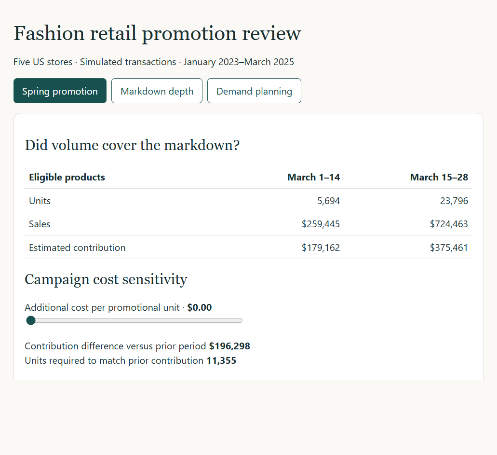
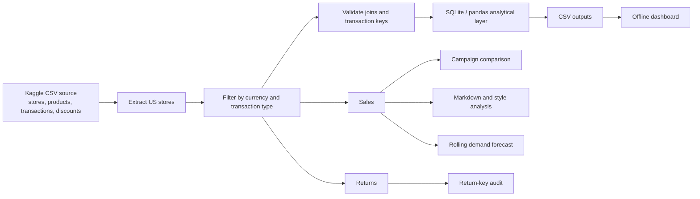

# Fashion Retail Promotion Analysis

**A decision-focused analytics project for evaluating spring promotions and demand planning.**

This repository analyzes the Kaggle *Global Fashion Retail Stores Dataset* across five US stores. It compares two SQL-style Python pipelines, an offline promotion dashboard, and a set of reproducible CSV outputs.

> **Source:** [Global Fashion Retail Sales by Ric. G., Kaggle, version 24](https://www.kaggle.com/datasets/ricgomes/global-fashion-retail-stores-dataset)

---

## Dashboard Preview

<p align="center">
  
</p>

The offline dashboard summarizes the campaign comparison, markdown economics, and demand-planning findings without requiring the source dataset or a live data connection.

---

## Project at a Glance

| Area | Deliverable | What it answers |
|---|---|---|
| Sales audit | `original-sql-analysis/outputs/scorecard.csv` | What is the US sales, refund, net-revenue, and basket-value picture? |
| Campaign review | `original-sql-analysis/outputs/spring_campaign.csv` | Did March 15-28, 2024 unit volume cover the 35% markdown? |
| Markdown economics | `original-sql-analysis/outputs/markdowns.csv` | How does contribution change at each discount level? |
| Product ranking | `original-sql-analysis/outputs/style_ranking.csv` | Which products lead each category by net revenue? |
| Return audit | `original-sql-analysis/outputs/return_quality.csv` | How often are return invoice-line keys repeated? |
| Demand planning | `outputs/weekly_predictions.csv` | What demand might the next promotional and regular weeks require? |
| Matched-style review | `outputs/comparison_groups.csv` | How do eligible styles compare with normalized pre-period controls? |
| Executive view | `dashboard.html` | How can campaign, markdown, and forecast findings be reviewed offline? |

---

## Pipeline



### 1. Data ingestion

The source is extracted locally rather than stored in this repository:

```text
data/
├── stores.csv
├── products.csv
├── transactions.csv
└── discounts.csv
```

The ingested tables are validated for:

- US store membership
- `USD` currency on every included US transaction
- Unique product IDs
- Valid transaction types and discount ranges
- Required numeric fields
- Unique sale invoice-line keys

The original SQL pipeline streams `transactions.csv` in chunks and loads the US subset into a temporary SQLite database. The advanced pipeline streams the same source with pandas and writes independent comparative outputs.

### 2. Business metric construction

**Estimated contribution**

```text
estimated contribution = discounted line revenue - (quantity × catalog production cost)
```

Production cost is used as a contribution proxy. Shipping, overhead, marketing spend, stockouts, and campaign costs are not included.

**Average order value**

```text
sale AOV = sum of sale line amounts / distinct sale invoice IDs
```

Returns are separated from sales for campaign and basket metrics.

**Matched comparison**

The advanced analysis:

1. Uses same-store and same parent-category groups.
2. Builds eight normalized pre-period weeks.
3. Compares the March 15-28, 2024 promotion window with March 1-14.
4. Uses only full-price subcategories as candidate controls.
5. Rejects control matches above an explicit normalized RMSE threshold of `0.25`.
6. Reports the target-to-control relative change descriptively.

This is not a causal experiment. Controls can be reused, and seasonality or product mix may explain part of the observed movement.

### 3. Demand forecasting

The SQL pipeline creates complete Monday-Sunday weeks and tests:

- Previous-week units
- A rolling four-week mean

It selects the lower-error model on a validation window, then measures eight rolling one-week-ahead test weeks.

The advanced pipeline adds a calendar-aware linear model using:

- Lagged weekly units
- Four-week lagged trend
- Scheduled category discount intensity

WAPE is calculated as:

```text
WAPE = sum(abs(actual - forecast)) / sum(actual)
```

Promotional schedule is treated as known, not predicted. Forecasts are demand proxies because stock availability is unknown.

### 4. Return audit

Return scenarios are intentionally kept separate:

| Scenario | Purpose |
|---|---|
| Raw recorded returns | Preserve every source return line |
| Exact duplicate rows removed | Illustrate a row-deduplication sensitivity |
| First row per invoice-line key | Stress test accounting treatment |

The audit does not determine the “correct” accounting treatment. The project also flags repeated return keys for financial review.

### 5. Reporting

The pipelines write structured CSV files for Excel or Power BI. `dashboard.html` is a static offline view of the verified campaign, markdown, and forecast snapshot.

---

## Repository Structure

```text
fashion_retail/
├── advanced_analysis.py
├── campaign_snapshot.csv
├── dashboard.html
├── requirements.txt
├── outputs/
│   ├── campaign.csv
│   ├── comparable_styles.csv
│   ├── comparison_groups.csv
│   ├── model_comparison.csv
│   ├── return_sensitivity.csv
│   └── weekly_predictions.csv
└── original-sql-analysis/
    ├── analyze.py
    ├── findings.md
    ├── requirements.txt
    ├── sql/
    └── outputs/
```

The two analysis tracks are independent:

- `advanced_analysis.py` rebuilds matched-style, forecast, campaign, return, and comparable-price outputs.
- `original-sql-analysis/analyze.py` rebuilds the SQLite scorecard, SQL reports, and baseline forecasts.

---

## Running the Project

### Requirements

- Windows
- Python 3.10+
- Kaggle source CSV files
- At least several GB of available RAM

### Install

```powershell
py -m pip install -r requirements.txt
```

Install the original SQL track separately if needed:

```powershell
py -m pip install -r original-sql-analysis/requirements.txt
```

### Download and extract source data

Download **Global Fashion Retail Sales, version 24** from Kaggle.

- For the advanced pipeline, extract the required CSV files into `data/` at the repository root.
- For the original SQL pipeline, extract the required CSV files into `original-sql-analysis/data/`.

### Run the advanced pipeline

```powershell
py advanced_analysis.py data
```

This rebuilds files in `outputs/`.

### Run the original SQL pipeline

```powershell
cd original-sql-analysis
py analyze.py data
```

This rebuilds the files in `original-sql-analysis/outputs/`.

### Open the dashboard

Open `dashboard.html` directly in a browser, or serve the repository locally:

```powershell
py -m http.server 8080
```

Then visit `http://127.0.0.1:8080/dashboard.html`.

---

## Verified Snapshot Results

The outputs included in this repository report:

- **US scope:** 1,687,764 source lines across five stores
- **Sale revenue:** $79,464,205.73
- **Refunds:** $4,440,694.03
- **Distinct sale invoices:** 1,140,790
- **Sale average basket:** $69.66
- **Repeated return invoice-line keys:** 5,223

For the March 2024 eligible-product comparison:

| Period | Units | Revenue | Estimated contribution |
|---|---:|---:|---:|
| March 1-14 | 5,694 | $259,445 | $179,162 |
| March 15-28 | 23,796 | $724,463 | $375,461 |

The promotion window sold approximately 4.18 times as many units and increased estimated contribution, but its commercial hurdle is not a causal ROI estimate.

The stored demand backtests report:

| Category | Test WAPE |
|---|---:|
| Feminine | 9.0% |
| Masculine | 9.6% |
| Children | 20.2% |

The previous-week model was selected for this baseline planning view. The children category requires the closest manual review.

---

## Decision Guidance

- Use the campaign figures for a **pilot and sensitivity review**, not a final causal conclusion.
- Use randomized store experiments or credible matched-store tests before a full rollout.
- Record marketing spend, returns, inventory, and stock availability before calculating true ROI.
- Treat deeper discounts as category-specific economics, not a universal promotion policy.
- Reconcile repeated return keys before publishing financial net-revenue reports.
- Review children’s demand forecasts manually before purchase-order decisions.

---

## Limitations

- Source transactions are simulated.
- Campaign comparisons are descriptive prior-period comparisons.
- Contribution uses catalog production cost only.
- Stockouts, footfall, sessions, acquisition spend, campaign spend, and channels are unavailable.
- Style results can contain mix differences across discount bands.
- Partial weeks are excluded from forecasts.
- The static dashboard does not automatically refresh from CSV files.

---

## Source

Ric. G., **Global Fashion Retail Sales**, Kaggle dataset, version 24.
